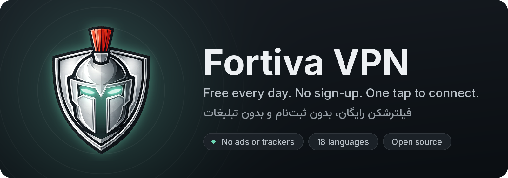
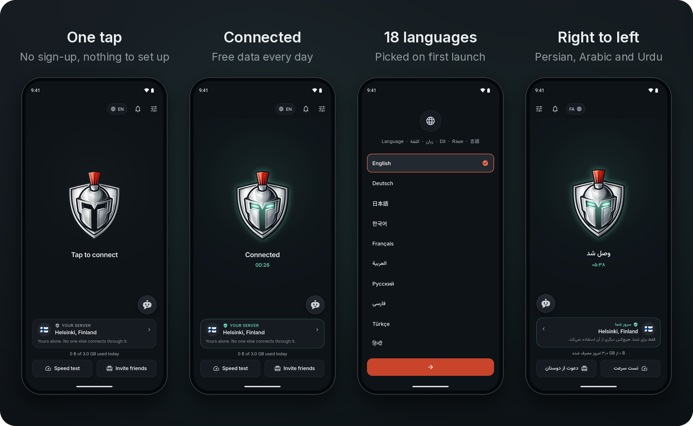
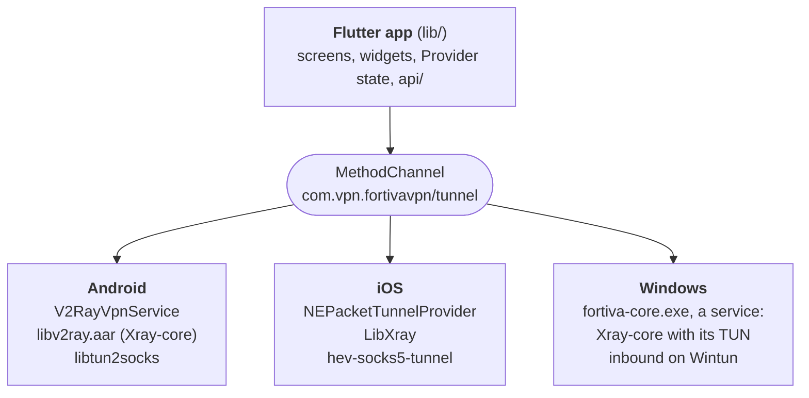

<p align="center">
  
</p>

<p align="center">
  <a href="https://github.com/SynAdam/fortivavpn/tags"></a>
  <a href="LICENSING.md"></a>
  
  
  
</p>

<p align="center"><b>English</b> · <a href="README.fa.md">فارسی</a></p>

<p align="center">
  <a href="https://play.google.com/store/apps/details?id=com.vpn.fortivavpn&amp;referrer=utm_source%3Dgithub"></a>
  <a href="https://fortivavpn.com/apk"></a>
  <a href="https://t.me/fortivavpn"></a>
</p>

<p align="center">
  
</p>

<p align="center">
  <a href="#features">Features</a> ·
  <a href="#download">Download</a> ·
  <a href="#how-it-works">How it works</a> ·
  <a href="#build-from-source">Build</a> ·
  <a href="#check-a-download">Check a download</a> ·
  <a href="#contributing">Contributing</a> ·
  <a href="#credits">Credits</a> ·
  <a href="#licence">Licence</a>
</p>

<div dir="rtl">

### فورتیوا به فارسی

فورتیوا یک فیلترشکن رایگان و قوی است: بدون ثبت‌نام، بدون تبلیغات و با اتصال با یک لمس. اپ را از [گوگل‌پلی](https://play.google.com/store/apps/details?id=com.vpn.fortivavpn&referrer=utm_source%3Dgithub) یا [سایت فورتیوا](https://fortivavpn.com/apk) بگیرید و خبرها را در [کانال تلگرام](https://t.me/fortiva_vpn) دنبال کنید.

این مخزن کد منبع اپ‌های فورتیوا برای اندروید، اندروید TV، iOS و ویندوز است. کد هر نسخه‌ی منتشرشده با تگ `vX.Y.Z` مشخص شده است. برای گزارش مشکل یا پیشنهاد، یک issue باز کنید. برای تغییر کد، یک pull request بفرستید. روش کار در [CONTRIBUTING.md](CONTRIBUTING.md) آمده است. راهنمای فارسی کامل‌تر در [README.fa.md](README.fa.md) است.

</div>

## Features

<table>
<tr>
<td width="33%" valign="top">

**Free every day**<br>
A data allowance that resets every day. Premium lifts the limit.

</td>
<td width="33%" valign="top">

**No sign-up**<br>
No email, no phone number and no password. Install the app and connect.

</td>
<td width="33%" valign="top">

**One tap**<br>
No configs to find and no keys to paste. The servers are built in and
update themselves.

</td>
</tr>
<tr>
<td width="33%" valign="top">

**Made for filtered networks**<br>
Fortiva is built for networks where ordinary VPNs fail to connect.

</td>
<td width="33%" valign="top">

**No ads, no trackers**<br>
No ad or tracking SDKs, and we never record the pages you open.
[Privacy policy](https://fortivavpn.com/privacy)

</td>
<td width="33%" valign="top">

**Your language**<br>
18 languages, with right-to-left screens for Persian, Arabic and Urdu.

</td>
</tr>
</table>

A speed test in the app compares your speed with and without the VPN.

## Download

| | Where to get it | Source |
| --- | --- | --- |
| **Android** phones and tablets | [Google Play](https://play.google.com/store/apps/details?id=com.vpn.fortivavpn&referrer=utm_source%3Dgithub), or the APK from [fortivavpn.com/apk](https://fortivavpn.com/apk) or from this repository's [Releases](https://github.com/SynAdam/fortivavpn/releases/latest). The [Lite APK](https://fortivavpn.com/apk/lite) is a smaller download for 32-bit phones that also runs on most 64-bit ones. | [`android/`](android/) |
| **Android TV** | The same app and APK as on phones | [`android/`](android/) |
| **iOS** | Build it from source | [`ios/`](ios/) |
| **Windows** | Build it from source | [`windows/`](windows/) |

New versions are announced on Telegram, in [English](https://t.me/fortivavpn)
and in [Persian](https://t.me/fortiva_vpn). Before you install an APK from
anywhere else, [check that it is ours](#check-a-download).

## What this repository is

The apps are developed in a private repository, and each change made there
comes here within minutes, as one commit. Each release is tagged `vX.Y.Z`
on the commit it was built from. The history here starts at version 2.2.0.

Three things in the builds we ship are not in this copy:

- **A few addresses and keys** that the app uses to reach our service.
  [`lib/api/built_in.dart`](lib/api/built_in.dart) and
  `assets/fallback/index.txt` are empty here.
- **Release and store tooling**, which needs our signing keys and store
  accounts.
- **Internal notes**: research, measurements and review correspondence.

The backend that hands out servers and accounts is not open source. A build
you make from this source talks to the same service as the app from the
store, under the same terms.

## How it works

The apps are one Flutter app (`lib/`) on top of a native tunnel for each
platform, built on [Xray-core](https://github.com/XTLS/Xray-core).



On first launch the app registers the device with the backend, with no
account, and receives credentials for the servers. Xray-core carries the
connection, and on Android and iOS a tun2socks layer feeds the device's TCP
and UDP traffic through it.

Android's native layer is derived from
[v2rayNG](https://github.com/2dust/v2rayNG). The cores are built from pinned
sources: see [`CORE-MAINTENANCE.md`](CORE-MAINTENANCE.md),
[`android/core/`](android/core/README.md), [`ios/core/`](ios/core/README.md)
and [`windows/core/`](windows/core/README.md).

## Build from source

You need the Flutter SDK (the version in
[`.github/workflows/ci.yml`](.github/workflows/ci.yml)), and for each
platform its own tools: JDK 17 and the Android SDK, Xcode on a Mac, or
Visual Studio 2022 with the C++ desktop workload on Windows.

```bash
flutter pub get
flutter analyze
flutter test
```

### Android

```bash
flutter run                          # a debug build on a phone or emulator
flutter build apk --debug
```

The core, `android/app/libs/libv2ray.aar`, is included. To build it
yourself from the pinned sources, run `android/core/build-in-linux.sh`. It
needs Docker, and it builds the core in a Linux container with the pinned
Go and Android NDK. See [`android/core/README.md`](android/core/README.md)
for how to check that your build matches ours. A release build needs your
own signing key: create `android/keystore.properties` with `storeFile`,
`storePassword`, `keyAlias` and `keyPassword`.

To install your build next to the app from the store, change
`applicationId` in [`android/app/build.gradle.kts`](android/app/build.gradle.kts).
Android does not install a build over ours, because yours is signed with a
different key.

### iOS

The core is not included because it is too large for this repository.
Build it first:

```bash
ios/core/build.sh          # Go and Xcode; writes ios/Frameworks/LibXray.xcframework
cd ios && pod install
```

Then set your own team, bundle identifiers and app group for the `Runner`
and `tunnel-ext` targets in Xcode. The packet tunnel runs only on a real
iPhone, not in the Simulator.

### Windows

See [`windows/core/README.md`](windows/core/README.md) for the tunnel service
and [`windows/installer/`](windows/installer/) for the installer.
`flutter build windows` builds the app.

### How releases are built

Each release is built from its tagged commit with Flutter 3.38.7:

- The Google Play bundle: `flutter build appbundle --release`.
- The APK on the [Releases](../../releases) page, fortivavpn.com and the
  Telegram channel, for 32-bit and 64-bit ARM phones:
  `flutter build apk --release --target-platform android-arm,android-arm64`.
- The Lite APK, a smaller download for 32-bit ARM that also runs on most
  64-bit phones: `flutter build apk --release --target-platform android-arm`.

A build from this source is not the same file as ours. A few addresses and
keys are not published (see [What this repository is](#what-this-repository-is)),
and ours is signed with our key.

## Check a download

The APKs on the [Releases](https://github.com/SynAdam/fortivavpn/releases) page, on
fortivavpn.com and in the Telegram channel are signed with our upload key.
Its certificate has this SHA-256 fingerprint:

```text
D4:A0:BA:F7:0A:62:66:54:A6:3F:F9:9A:B7:27:5D:85:B4:3D:77:6A:26:85:4D:24:48:AC:2F:6D:10:AC:B1:41
```

To check a file, run `apksigner verify --print-certs FortivaVPN-X.Y.Z.apk`.
apksigner is in the Android SDK build tools. The line "Signer #1
certificate SHA-256 digest" must show the same value, in lower case and
without colons. If it shows another value, the file is not ours, so do not
install it.

Each release page also carries `SHA256SUMS`, with the SHA-256 of both
APKs, and GitHub shows each file's SHA-256 under Assets. To check a
download against it, save `SHA256SUMS` in the folder with the APK and run
`sha256sum -c --ignore-missing SHA256SUMS` there.

The app from Google Play is signed by Google Play's app signing key, not by
our upload key. Its certificate has this SHA-256 fingerprint:

```text
E1:F5:F9:1D:AA:A7:F9:AE:07:FF:3B:02:06:0F:6E:33:BA:21:21:5C:16:F2:EA:70:9B:E0:B1:96:D7:C9:08:A5
```

## Contributing

Pull requests are welcome. An accepted change comes here within minutes of
being merged, in a commit that names you as a co-author, and ships in the
next release.
[CONTRIBUTING.md](CONTRIBUTING.md) has the steps, the checks and the terms.

- **Found a bug or have an idea?** [Open an issue](https://github.com/SynAdam/fortivavpn/issues/new/choose)
  with one of the forms, in English or Persian.
- **Want to change the code?** Open a pull request. See
  [CONTRIBUTING.md](CONTRIBUTING.md).
- **Looking for something to do?** Start with the issues labelled
  [good first issue](https://github.com/SynAdam/fortivavpn/labels/good%20first%20issue)
  or [help wanted](https://github.com/SynAdam/fortivavpn/labels/help%20wanted).
- **Translations:** the app is in 18 languages, one file each in
  [`lib/l10n/`](lib/l10n/). A fix to one translated string is a good first
  pull request.
- **Need help with the app, an account or a payment?** See
  [SUPPORT.md](SUPPORT.md). Issues are public, so do not ask about an
  account or a payment in one.
- **Found a security problem?** Follow [SECURITY.md](SECURITY.md). Do not
  open an issue for it.

The [code of conduct](CODE_OF_CONDUCT.md) applies in issues, pull requests
and everywhere else in this project.

## Credits

Fortiva VPN is built on the work of these open-source projects. Thank you to
everyone who wrote and maintains them.

- [ZedSecure](https://github.com/CluvexStudio/ZedSecure) by CluvexStudio, a
  VPN and proxy client. Our core includes the autoselect outbound that
  CluvexStudio wrote for Xray-core, taken from
  [their Xray-core fork](https://github.com/CluvexStudio/Xray-core). Thank
  you for publishing it.
- [Xray-core](https://github.com/XTLS/Xray-core) by XTLS, the network core
  the app is built on.
- [libXray](https://github.com/XTLS/libXray) by XTLS, a wrapper that makes
  Xray-core easier to use in mobile apps.
- [v2rayNG](https://github.com/2dust/v2rayNG) by 2dust, an Android client for
  Xray-core. Our Android native layer is derived from it.
- [AndroidLibXrayLite](https://github.com/2dust/AndroidLibXrayLite) by 2dust,
  the binding that lets Android apps use Xray-core.
- [psiphon-tunnel-core](https://github.com/Psiphon-Labs/psiphon-tunnel-core)
  by Psiphon Inc., Psiphon's tunnel library.
- [shadowsocks-android](https://github.com/shadowsocks/shadowsocks-android),
  an Android client. A few files of our Android native layer come from it.
- [sing](https://github.com/SagerNet/sing) and
  [sing-shadowsocks](https://github.com/SagerNet/sing-shadowsocks) by
  SagerNet, Go libraries that Xray-core uses.
- [BadVPN](https://github.com/ambrop72/badvpn) by ambrop72, whose tun2socks
  the Android app uses.
- [v2ray-rules-dat](https://github.com/Loyalsoldier/v2ray-rules-dat) by
  Loyalsoldier, the `geoip.dat` and `geosite.dat` data files.
- [MMKV](https://github.com/Tencent/MMKV) by Tencent, a key-value store that
  keeps the Android native layer's settings.
- [Tun2SocksKit](https://github.com/EbrahimTahernejad/Tun2SocksKit) by
  EbrahimTahernejad, a Swift package of hev-socks5-tunnel.
- [hev-socks5-tunnel](https://github.com/heiher/hev-socks5-tunnel) by heiher,
  a small and fast tun2socks tunnel.
- [Wintun](https://www.wintun.net) by WireGuard LLC, a network adapter driver
  for Windows.
- [Flutter](https://flutter.dev) and the Dart packages listed in
  [`pubspec.yaml`](pubspec.yaml).

[THIRD-PARTY-NOTICES.md](THIRD-PARTY-NOTICES.md) lists the licence of each
project.

## Licence

- **The Android and Windows builds are GPL-3.0.** Both contain GPL-3.0 code
  from other projects. [LICENSE](LICENSE) is the licence text.
- **The iOS build** contains no GPL code and is not licensed for
  redistribution.
- **The shared Flutter code** (`lib/`) is licensed under GPL-3.0 as part of
  the Android and Windows builds.

[LICENSING.md](LICENSING.md) says which licence each build and each folder
is under. [THIRD-PARTY-NOTICES.md](THIRD-PARTY-NOTICES.md) lists every
component and its licence.

## Name and logo

The licence gives no rights to the Fortiva VPN name and logo as
trademarks. If you publish a modified version, give it its own name, icon
and application ID, and do not present it as ours. These are additional
terms under section 7 of the GPL; see [LICENSING.md](LICENSING.md).

<br>

<p align="center">
  <sub><a href="https://fortivavpn.com">fortivavpn.com</a> ·
  <a href="https://fortivavpn.com/privacy">Privacy</a> ·
  <a href="https://t.me/fortivavpn">Telegram</a></sub>
</p>
